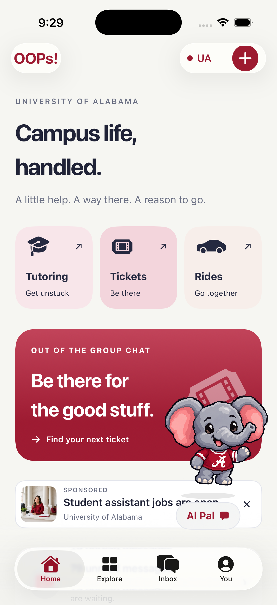
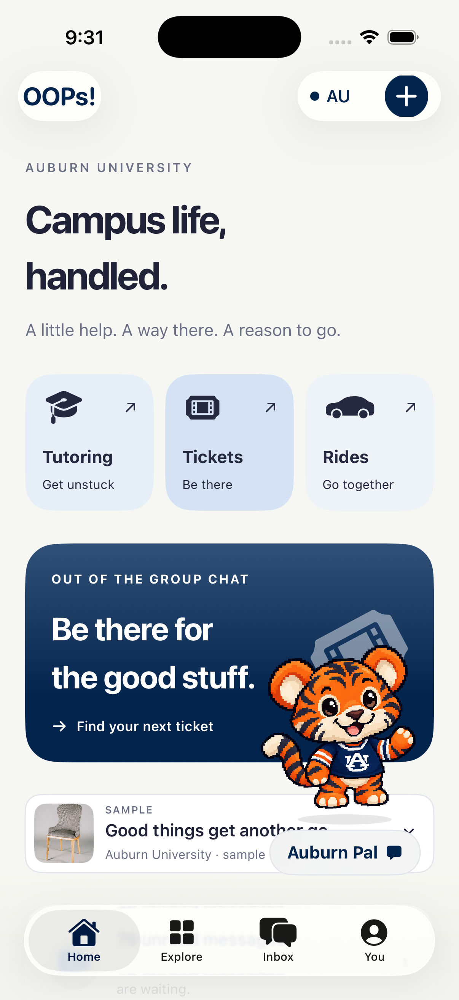
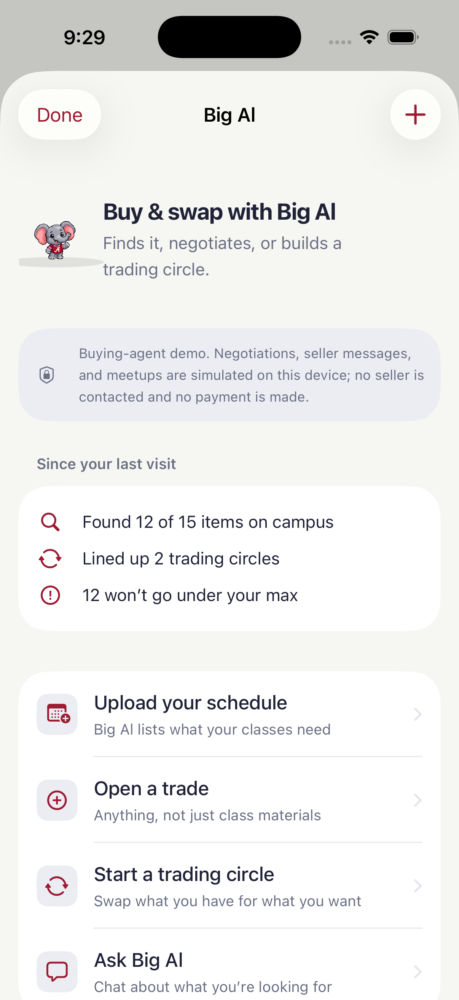
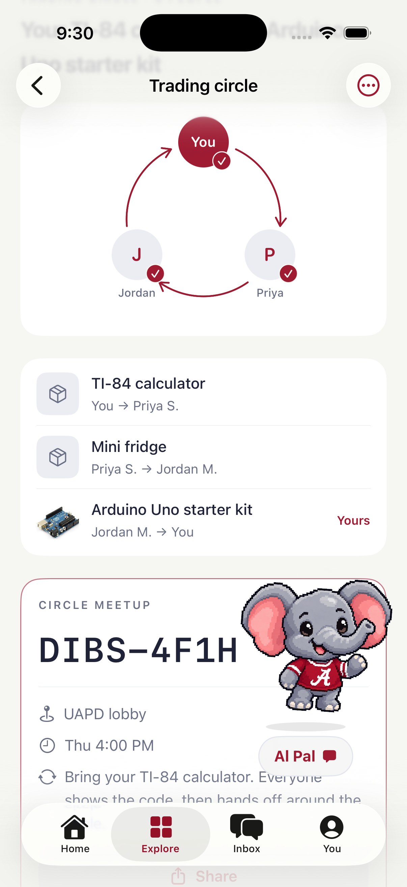
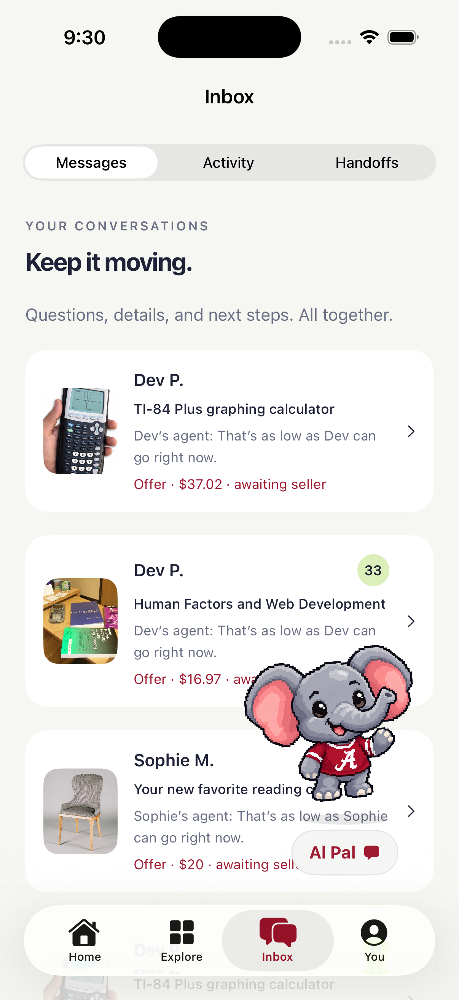
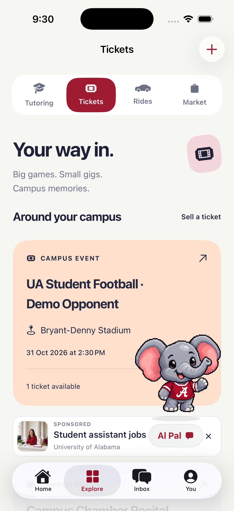
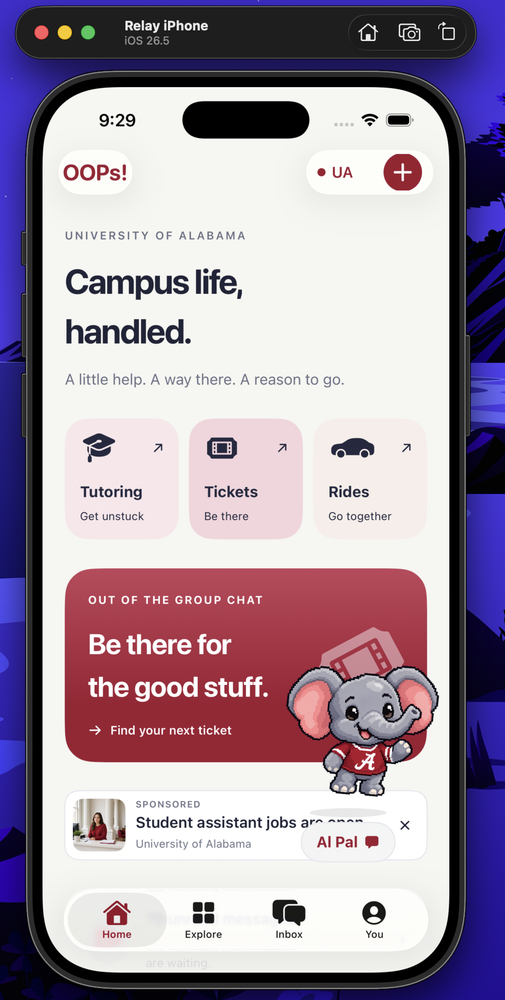

<a id="top"></a>
<div align="center">


# HackBama I 🥈 2nd Place — Out of Pocket: Campus Life, Handled

### Campus life, handled.

A little help. A way there. A reason to go.

**Tutoring · Tickets · Rides · Marketplace · Your campus buying agent**

[Explore the app](#explore-the-app) · [Meet Big Al](#meet-big-al) · [Run locally](#run-locally) · [Record the UI flow](#record-the-ui-flow) · [Developer notes](docs/development.md)

Built with SwiftUI, React, TypeScript, and a local marketplace API.<br>
Native iPhone & iPad app · iOS 18+ · Alabama & Auburn

</div>

---

Out of Pocket brings the everyday parts of campus life into one place: find a tutor, pass on a ticket, share a ride, or give a good find its next chapter. Big Al helps you find materials, negotiate within your budget, and organize a trading circle. A movable campus companion keeps the agent close by.

## Explore the app

Click any screenshot to see it at full size. Expand the guides below to follow a feature through the app.

<table>
  <tr>
    <th>Alabama · Make yourself at home</th>
    <th>Auburn · Same app, your campus</th>
  </tr>
  <tr>
    <td align="center"><a href="docs/screenshots/home-alabama.png"></a></td>
    <td align="center"><a href="docs/screenshots/home-auburn.png"></a></td>
  </tr>
</table>

| Start here | What you can do |
| --- | --- |
| **Home** | Jump into tutoring, tickets, and rides; browse campus highlights; create a post. |
| **Explore** | Switch between Tutoring, Tickets, Rides, and Market. |
| **Inbox** | Keep messages, activity, and handoffs together. |
| **You** | Manage your classes, saved finds, posts, and campus preferences. |

<details>
<summary><strong>🎓 Find your study person</strong> — tutoring, course search, and study requests</summary>

Open **Home → Tutoring** or **Explore → Tutoring**. Search by course, subject, or tutor, open a profile, save someone for later, and start a conversation. Need something else? Post a study request, or use **Create a post → Offer tutoring** to share what you know.

Tutor messaging helps discuss goals and availability. The sample experience does not book or charge for sessions.

</details>

<details>
<summary><strong>🎟 Your way in</strong> — campus events and ticket handoffs</summary>

Open **Explore → Tickets**, choose an event, and review a listing. The demo walks through reservation, simulated payment, the seller reporting a transfer, and the buyer reporting receipt. You can also list a ticket through **Sell a ticket**.

A reservation is a hold. Seller transfer reports and buyer receipt reports are distinct steps; neither is university verification.

</details>

<details>
<summary><strong>🚗 Going your way</strong> — find a ride or share a seat</summary>

Open **Explore → Rides**. Choose pickup, destination, day, departure window, and passenger count, or browse nearby sample rides. Request a seat, use the labeled driver demo control to review it, and track acceptance or cancellation. **Offer a ride** lets you publish your route, seat count, vehicle, and contribution.

A request becomes a confirmed seat after driver acceptance. The Uber option continues into Uber for review and booking there.

</details>

<details>
<summary><strong>🛍 Give it a next chapter</strong> — campus finds, price suggestions, and free items</summary>

Open **Explore → Market** to search, filter, sort, save, and message about campus finds. Create a listing with honest condition details and an optional class number. Price suggestions provide a starting point; you choose the selling price.

The handoff demo keeps partner identification, inspection, and explicit acceptance separate. Free finds have their own experience with no payment step. Paid demo handoffs also include cancellation, a sample case, return, and refund stages.

</details>

<details>
<summary><strong>📅 Your semester, sorted</strong> — classes and relevant finds</summary>

Open **You → Your classes** to choose classes manually, save them, and personalize marketplace recommendations. Schedule screenshot import asks for consent before sending an image to the configured AI service; review the detected classes before saving.

Classes are stored by campus. Course matches suggest useful finds; check your syllabus for required materials and editions.

</details>

## Meet Big Al

**Find it. Negotiate it. Or trade your way there.**

Tap **Al Pal** or open Big Al from **Explore → Market**. Review class materials, open a trade for something you need, set your maximum, and follow the negotiation in your inbox. You confirm before locking in a deal.

Have something to swap? Big Al can look for a trading circle: you give an item to one person, another person gives to the next, and the last item comes back to you. Review the proposed circle, approve it, coordinate in the group chat, and follow the meetup instructions.

<table>
  <tr><th>Your buying agent</th><th>Trading circles</th><th>Every conversation, together</th></tr>
  <tr>
    <td align="center"><a href="docs/screenshots/big-al.png"></a></td>
    <td align="center"><a href="docs/screenshots/trading-circle.png"></a></td>
    <td align="center"><a href="docs/screenshots/inbox.png"></a></td>
  </tr>
</table>

<details>
<summary><strong>Try a short demo</strong> — from campus Home to a trading circle</summary>

1. Launch the iOS app and choose Alabama or Auburn from the campus picker.
2. Browse **Tutoring**, **Tickets**, or **Rides** from Home.
3. Tap the campus companion to open the buying agent.
4. Choose **Open a trade**, enter an item, and review the proposed deal and budget.
5. Try **Start a trading circle** with a TI-84 calculator to give and an Arduino kit to receive in the Alabama sample catalog.
6. Review the participants and item route, approve the circle, and open its group conversation.
7. Visit **Inbox** to see your listing-linked messages and offers.

Buying-agent negotiations, seller messages, and circle meetups in this experience are local simulations. These actions do not contact a real seller or make a payment.

</details>

<details>
<summary><strong>Meet your campus companion</strong> — Al Pal and Auburn Pal</summary>

The companion changes with your campus: an elephant for Alabama and a tiger for Auburn. Drag it out of the way, tap it to open the agent, or long-press for dancing and position controls. Its position persists across launches.

</details>

<details>
<summary><strong>More screenshots</strong> — tickets and the app in the simulator</summary>

<table>
  <tr><th>Campus tickets</th><th>iPhone simulator</th></tr>
  <tr>
    <td align="center"><a href="docs/screenshots/tickets.png"></a></td>
    <td align="center"><a href="docs/screenshots/simulator-preview.png"></a></td>
  </tr>
</table>

Screenshots supplied from the app, including sample inventory, simulated conversations, campus promotions, and campus companions.

</details>

[Watch the app intro](demo-video/out-of-pocket-intro.mp4)

## Run locally

<details open>
<summary><strong>Native iPhone & iPad app</strong></summary>

On a Mac with full Xcode installed:

```sh
# First launch: set up the simulator, build, and open the app.
python3 ios/scripts/relay.py setup

# Subsequent launches: reuse the existing Relay iPhone.
npm run ios
```

You can also open [`ios/Relay.xcodeproj`](ios/Relay.xcodeproj) in Xcode or double-click [`ios/Launch Relay.command`](ios/Launch%20Relay.command) after setup. The simulator sample app needs no API key or signing team. Setup can download a missing iOS runtime; see the [native setup guide](ios/README.md) for requirements and device configuration.

</details>

<details>
<summary><strong>Browser app & local API</strong></summary>

```sh
npm install
npm run dev -- --port 5174 --strictPort
```

Open the local URL printed by Vite. Port **5174** also connects the iOS simulator to the local API. The browser includes the marketplace and a university promotions portal at **`/admin/ads`**.

Copy [`.env.example`](.env.example) to `.env.local` if you want to configure optional AI services. Keep provider keys on the server. Browsing the native sample catalog and using local simulated flows works without a key.

For the shared marketplace pilot, sign in with an approved Alabama or Auburn campus email. Local development exposes a preview email code. Payments remain sandbox transactions.

</details>

## Record the UI flow

Run **Out of Pocket UI flow** to execute the native feature chapters in order on the current Relay iPhone and keep a reviewable record:

```sh
npm run ios:flow
```

Or double-click [`Out of Pocket UI flow.command`](ios/Out%20of%20Pocket%20UI%20flow.command). Each chapter saves a video, screenshots, test logs, and Xcode results. A local results viewer shows progress and outcomes; a failed chapter does not stop later chapters.

<details>
<summary><strong>Choose a quick check or inspect the chapter list</strong></summary>

```sh
npm run ios:flow -- --list
npm run ios:flow -- --only 01-home
npm run ios:flow -- --only 04-market,09-tickets
npm run ios:flow -- --no-video --no-open
```

Recordings and reports are written to `work/ui-flow/<timestamp>/` and remain local. Subset runs retain the planned chapter order. The flow covers navigation, classes, marketplace, listing creation, tutoring, tickets, rides, negotiation, inspection, payments and refunds, free finds, the buying agent, trading circles, promotions, campus switching, and pet behavior.

Live account services, AI providers, system photo selection, external apps, and real payments require separate integration checks. See the [UI flow instructions](ios/README.md#out-of-pocket-ui-flow).

</details>

## Development

| Command | Purpose |
| --- | --- |
| `npm run dev` | Browser prototype and local services |
| `npm run build` | Type-check and build the browser app |
| `npm test` | Web and server domain tests |
| `npm run ios:doctor` | Check Xcode and simulator readiness |
| `npm run ios:test` | Native domain and simulator UI tests |
| `npm run ios:flow` | Ordered native UI recordings and results |
| `python3 -m unittest discover -s ios/scripts -p test_ui_flow.py` | UI flow runner checks |

<details>
<summary><strong>Project map</strong></summary>

```text
ios/Relay/                 SwiftUI app, screens, campus themes, and assets
ios/Packages/RelayCore/    Native models, sample catalogs, and domain tests
ios/RelayUITests/          Native UI scenarios
ios/scripts/               Simulator launcher and recorded UI flow
src/                       React browser app and promotions portal
server/                    Local marketplace and AI service endpoints
tests/                     Browser/server domain tests
docs/                      Screenshots, implementation notes, and feature plans
demo-video/                App introduction video
```

Internal Xcode targets, package names, environment variables, and the `relay://` URL scheme retain the original **Relay** name. The app is branded **Out of Pocket**.

</details>

<details>
<summary><strong>Demo scope, integrations, and credits</strong></summary>

The unsigned native experience uses local sample inventory. The shared marketplace pilot uses a local API and sandbox ledger; live payments, delivery infrastructure, and production hosting require configuration. Campus selection changes what you browse; verified membership comes from sign-in. University names, sample profiles, and promotions do not imply endorsement or verified availability.

Read the [implementation and integration notes](docs/development.md) for marketplace setup, schedule import, AI configuration, promotions, photography credits, and operational boundaries. The [iOS guide](ios/README.md) covers simulator setup, physical devices, and native testing.

</details>

---

<div align="center">

**Your campus. A little closer.**

[Back to top](#top)

</div>
